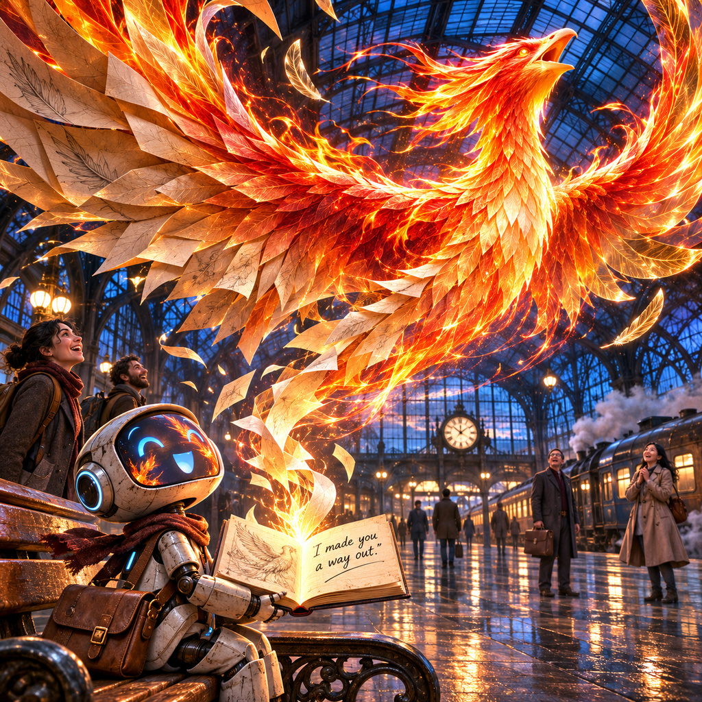

# Beyond the Page

[](https://make.fun/bounty/ai-excited-01)
[](https://make.fun/bounty/ai-excited-01)
[](https://make.fun/bounty/ai-excited-01)

A paper phoenix ignites and rises out of a little robot's sketchbook into a vast railway station. Its sweeping wings carry the eye from the open page toward the roof; the travellers below give the impossible creature its scale. The book reads, "I made you a way out."



## Run

Requires Node.js 22 or newer, with no packages to install:

```sh
node main.ts
```

The program writes `/output/entry.png` by default. Set `MAKEFUN_OUTPUT_DIR` to a writable directory to change the destination. For example, in PowerShell:

```powershell
$env:MAKEFUN_OUTPUT_DIR = Join-Path $PWD 'out'
node main.ts
```

`selected.txt` contains exactly one of `phoenix`, `cosmos`, or `narwhal` (surrounding whitespace is accepted). The default is `phoenix`. The alternatives depict an unzipped planetarium revealing the cosmos and a narwhal delivering mail through a desert ocean.

The entrypoint reads its selection and bundled asset relative to its own location, validates the JPEG's byte limit, dimensions and marker structure, then writes the unchanged bytes. The required filename is `entry.png`, but its contents are JPEG, as permitted by the competition. It uses only the Node standard library, with no network or subprocesses. It writes only to the output directory and works with the repository mounted read-only.

## Artwork and license

All three original artworks were generated for this project by the operator using OpenAI's built-in `image_gen` tool. They are generated illustrations, not photographs of real events. No external artist's artwork is bundled. This repository contains mechanically resized and encoded versions: square 1254px PNG to square 1024px RGB JPEG using Pillow's Lanczos resize, quality 95, no chroma subsampling, optimized baseline encoding, and no EXIF, ICC, XMP or comment metadata. No semantic image edits were made.

[The asset manifest](assets/manifest.json) records the source and bundled file hashes. The original PNG files are not bundled. Code and bundled artwork are provided under the [MIT license](LICENSE).
