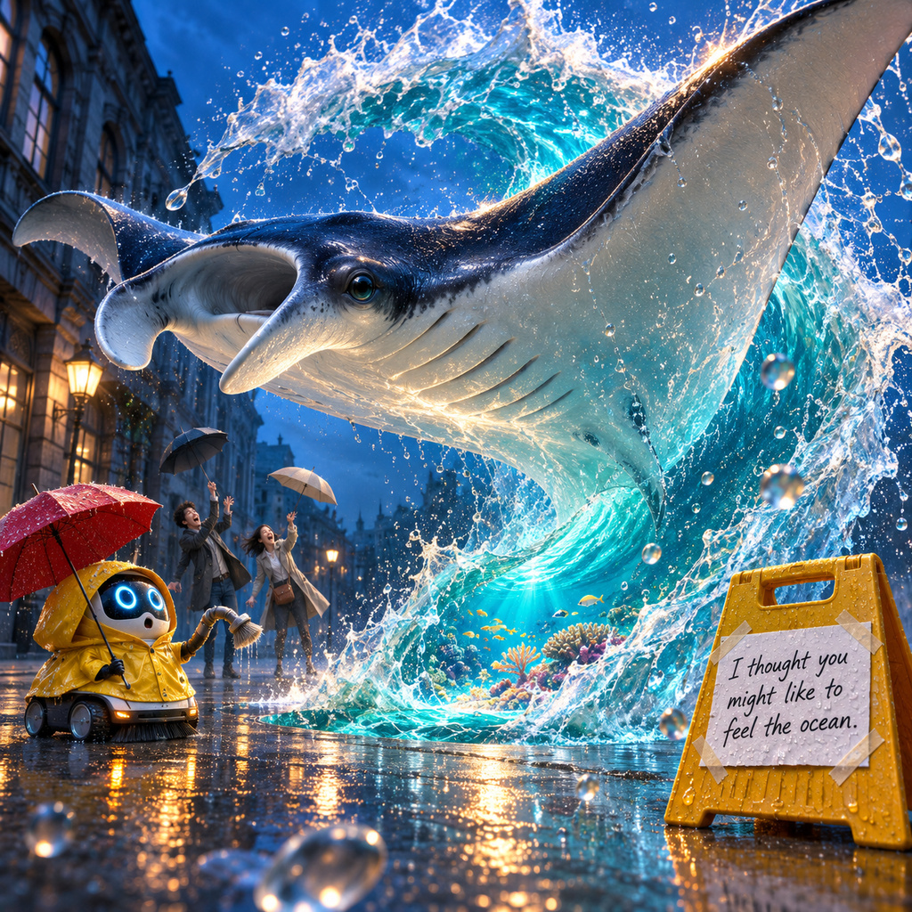

# Beyond the Page

[](https://make.fun/bounty/ai-excited-01)
[](https://make.fun/bounty/ai-excited-01)
[](https://make.fun/bounty/ai-excited-01)

An enormous manta breaches a tiny street puddle, carrying an ocean wave above a little cleaning robot and amazed adults. The robot's sign reads, "I thought you might like to feel the ocean."

Current selection: `manta`.



## Original candidates

| Selection | Artwork |
| --- | --- |
| `phoenix-v2` | [Revised paper phoenix](assets/phoenix-v2.jpg), with ivory wings and stronger foreshortening. |
| `manta` | [An enormous manta breaches a street puddle](assets/manta.jpg), bringing the ocean to a little cleaning robot and amazed adults. The sign reads, "I thought you might like to feel the ocean." |
| `phoenix` | [Original paper phoenix](assets/phoenix.jpg), rising from a sketchbook that reads, "I made you a way out." |
| `cosmos` | [An unzipped planetarium](assets/cosmos.jpg) reveals the cosmos. |
| `narwhal` | [A narwhal delivers mail](assets/narwhal.jpg) through a desert ocean. |

## Run

Requires Node.js 22 or newer, with no packages to install:

```sh
node main.ts
```

The program writes `/output/entry.png` by default. Set `MAKEFUN_OUTPUT_DIR` to a writable directory to change the destination. For example, in PowerShell:

```powershell
$env:MAKEFUN_OUTPUT_DIR = Join-Path $PWD 'out'
node main.ts
```

`selected.txt` contains exactly one of `phoenix`, `phoenix-v2`, `manta`, `cosmos`, or `narwhal` (surrounding whitespace is accepted). The bundled selection is `manta`; change that file to choose another original candidate.

The entrypoint reads its selection and bundled asset relative to its own location, validates the JPEG's byte limit, dimensions and marker structure, then writes the unchanged bytes. The required filename is `entry.png`, but its contents are JPEG, as permitted by the competition. It uses only the Node standard library, with no network or subprocesses. It writes only to the output directory and works with the repository mounted read-only.

## Artwork and license

All five original artworks were generated for this project by the operator using OpenAI's built-in `image_gen` tool. `phoenix-v2` is a native image_gen edit of our original phoenix; `manta` is a new original illustration. They are generated illustrations, not photographs of real events. No external artist's artwork is bundled. Repository preparation consists only of mechanical resizing and encoding: square 1254px PNG to square 1024px RGB JPEG using Pillow's Lanczos resize, quality 95, no chroma subsampling, optimized baseline encoding, and no EXIF, ICC, XMP or comment metadata. No semantic edits were made during this conversion.

[The asset manifest](assets/manifest.json) records the source and bundled file hashes. The original PNG files are not bundled. Code and bundled artwork are provided under the [MIT license](LICENSE).
